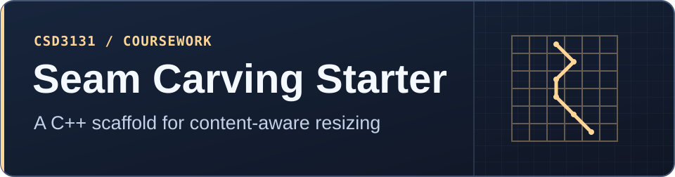

<div align="center">



# Seam Carving Starter

Shared C++17 coursework scaffold for experimenting with seam-carving algorithms.


[Build the starter](#build-and-check-the-scaffold) · [Team task plan](docs/TASKS.md)

</div>

**Status: scaffold only.** The launcher, shared interfaces, and starter smoke tests are in place. The seam-finding algorithms and image-resizing pipeline are still TODO.

## Build and check the scaffold

Prerequisites: a C++17 compiler and CMake 3.20+. No Python, OpenCV or extra image library is required to build this scaffold. Windows with Visual Studio C++ desktop tools:

```powershell
cmake -S . -B build
cmake --build build --config Release --parallel 4
ctest --test-dir build -C Release --output-on-failure
.\build\Release\seamcarve.exe --status
```

These direct commands do not need PowerShell script permission. On a single-configuration generator, configure with `-DCMAKE_BUILD_TYPE=Release` and run `./build/seamcarve` (or `build\seamcarve.exe` on Windows Ninja).

Expect **2/2 starter smoke tests passed**, followed by a status listing all implementation modules as **TODO**. The tests check the launcher’s help and status commands. See the [testing plan](tests/README.md) for algorithm test cases.

## Repository layout

| Path | Purpose |
| --- | --- |
| [`include/seamcarving/seam.hpp`](include/seamcarving/seam.hpp) | Shared image, energy map, and seam contracts |
| [`src/`](src/) | Launcher plus placeholders for image I/O, energy, seam finding, and resizing |
| [`tests/`](tests/) | Planned tests and a small energy-map fixture |
| [`data/`](data/) | A generated RGB image fixture |
